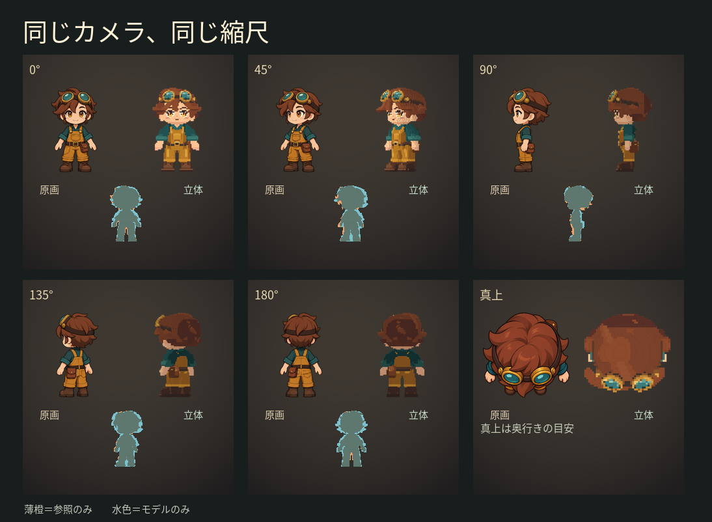

# Mochi Cheeks: Voxel Character Workflow

[日本語](README.md) · [Japanese production guide](docs/guide-ja.md) · [Skill instructions](skills/voxel-character-workflow/SKILL.md)

A portable Codex skill for building a **solid, editable voxel character**. Generate a six-view design sheet first: front, true side, rear, front oblique, rear oblique, and overhead. Review those drawings before sculpting real voxel volumes, then render and check the model against the references. The optional Blender helper registers approved views; it neither generates the concept art nor builds the model.



The mechanic is shown only as a workflow example. Its source drawings and editable character assets are not included.

## Run the example

Install Blender or use its executable path. Tested with Blender 4.3.2. From the repository root, register the included geometric test plates:

```sh
blender --background --python-exit-code 1 \
  --python skills/voxel-character-workflow/scripts/register_blender_refs.py \
  -- examples/bolt-bot/manifest.json bolt-bot-refs.blend
```

Open the resulting Blender file. In **01 · REFERENCE PLANES**, show the desired reference and switch to the matching `ORTHO` camera. The six transparent images are packed and travel with the file. The helper only creates a new scene; it refuses to overwrite an existing file.

For your own drawings, use the [manifest template](skills/voxel-character-workflow/assets/reference-manifest.example.json). Use consistently cropped landmarks, align the side views by crown height and the midpoint of the boot soles, and treat the overhead illustration as a depth guide rather than an orthographic scan. Each input can have a different pixel size. The [construction reference](skills/voxel-character-workflow/references/construction-and-face.md) goes into more detail.

For Codex, keep the entire [skill folder](skills/voxel-character-workflow/) together so its scripts and references resolve. For example: “Use this workflow to generate and review a six-view sheet, then build a static voxel model. Keep the approved front face unchanged if we revise only the profile.” Cloning this repository alone does not install a skill.

## Smoke test

```sh
python3 tests/smoke.py
```

The test runs Blender on the bundled example and reopens the result without the source PNGs. It checks the reference/camera transforms, packed images and refusal to overwrite. No network access or third-party Python packages are needed for the test.
