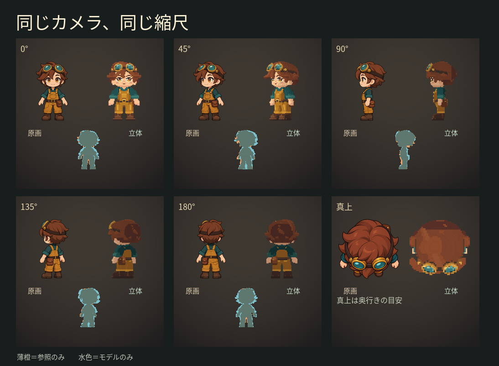

# もちほっぺフロー：ボクセルキャラクター制作スキル

原画を3D空間に置き、正面・横・斜めから同じ立体を見比べながら、ボクセルキャラクターを作るためのCodexスキルです。6枚の参照をBlenderに置くところはスクリプト化し、形や色はキャラクターごとに作ります。画像から立体を自動生成するツールではありません。

[English](README.en.md) · [日本語の制作ガイド](docs/guide-ja.md) · [SKILL.md](skills/voxel-character-workflow/SKILL.md)



図は作例です。整備士の編集用モデルや原画データは同梱していません。

## すぐ試す

Blenderが必要です（4.3.2で確認）。リポジトリのルートで、同梱の幾何学トイの参照6枚を登録します。

```sh
blender --background --python-exit-code 1 \
  --python skills/voxel-character-workflow/scripts/register_blender_refs.py \
  -- examples/bolt-bot/manifest.json bolt-bot-refs.blend
```

新しい `.blend` には位置合わせ済みの参照画像と6台の正投影カメラが入ります。上書きは不可です。画像は内包されるため、元のPNGがない場所でも開けます。開いたら「01 · REFERENCE PLANES」で必要な面だけ表示し、同じ名前の `ORTHO` カメラに切り替えてください。トイ画像は配置の動作確認用で、モデルは生成されません。

自分の原画には[マニフェストのひな型](skills/voxel-character-workflow/assets/reference-manifest.example.json)を使えます。正面〜背面の5枚は頭頂・靴底・靴底の中央で位置合わせし、真上は奥行きの目安として使います。

Codexで使うときは、[スキルのフォルダ](skills/voxel-character-workflow/)をひとまとまりで利用し、「このスキルで原画を配置して、まず静止モデルまで」と依頼します。配布用ファイルであり、このリポジトリを取得するだけでインストールされるわけではありません。

### 動作確認

```sh
python3 tests/smoke.py
```

ディスクに書き出した `.blend` を元画像なしで開き直し、参照とカメラの向き、足裏・全高、上書き拒否を確認します。
